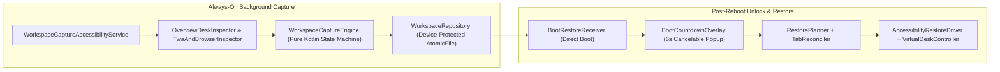

# Googlebook App Restorer

**Googlebook App Restorer** automatically captures and restores your entire multi-desk, multi-display Android Desktop / Googlebook workspace across reboots — **without requiring root or ADB**.

Once armed, it runs silently in the background (even when the app window is closed), tracks open windows, exact freeform bounds, snapped/maximized/fullscreen/minimized states, Virtual Desks (`Desk 1..N`), external monitors, Trusted Web Apps (TWAs / WebAPKs), multi-instance apps (Chrome, Files), and open Chrome tab URLs. After a reboot and screen unlock, a quick floating countdown pop-up (`6s`) restores your workspace automatically unless you press **Cancel** (`Esc`).

---

## Key Features

- **Zero Root / Zero ADB**: Uses strictly standard, user-grantable Android APIs (`AccessibilityService`, `SYSTEM_ALERT_WINDOW`, `PACKAGE_USAGE_STATS`, `POST_NOTIFICATIONS`) with guided one-tap Settings deep links.
- **Always-On Background Capture**: Keeps tracking even after closing the app window via a bound `AccessibilityService` + `stopWithTask="false"` foreground service, flushing atomically (`AtomicFile` + `fsync`) to Device-Protected Storage on Power Menu, screen-off, and shutdown.
- **Multi-Desk & Multi-Display Fidelity (Schema v6)**:
  - Tracks windows across `Desk 1..N` and connected external displays (`DisplayManager` + `WindowMetrics`).
  - Automatically recreates missing Virtual Desks in Overview on reboot, activates each desk in sequence, and restores proportional scaled bounds if an external monitor was unplugged.
- **Exact Window Geometry & Minimized Apps**:
  - Restores exact pixel bounds and states (`FREEFORM`, `MAXIMIZED`, `FULLSCREEN`, `SNAPPED_LEFT`, `SNAPPED_RIGHT`, `MINIMIZED`) and Z-order stacking, using `ActivityOptions.setLaunchBounds` plus WMShell caption-button / edge-drag verification.
- **TWAs, Multi-Instance Windows & Chrome Tab Preservation**:
  - Distinguishes standalone TWAs / WebAPKs and Gemini from Chrome browser windows.
  - Preserves multiple Chrome and Files (`DocumentsUI`) windows and reconciles open Chrome tab URLs without creating duplicate tabs.
- **Smart Companion Filtering**:
  - Automatically ignores transient cross-device streaming surfaces (`Connected Phone`, `Device Link Debug`, `Cross-Device Services`) and any temporary desks spawned solely for them.
- **Cancelable Auto-Restore Pop-Up on Unlock**:
  - Waits until the lock screen (`KeyguardManager`) is dismissed after reboot, then shows a compact centered countdown card (`"Workspace restoring automatically in 6s…"` with **Cancel** / `Esc`, **Restore now**, and **Choose…**).
- **100% Offline & Private**: Requests **zero network permissions** (`INTERNET` is not declared). All workspace state stays strictly in local Device-Protected Storage.

---

## Architecture



### Module Layout

| Package | Responsibility |
| :--- | :--- |
| `capture/` | Pure-Kotlin [`WorkspaceCaptureEngine`](app/src/main/kotlin/com/google/android/desktop/apprestorer/capture/WorkspaceCaptureEngine.kt), [`WindowGeometryClassifier`](app/src/main/kotlin/com/google/android/desktop/apprestorer/capture/WindowGeometryClassifier.kt), [`UsageStatsWorkspaceReconciler`](app/src/main/kotlin/com/google/android/desktop/apprestorer/capture/UsageStatsWorkspaceReconciler.kt), and [`KnownPackages`](app/src/main/kotlin/com/google/android/desktop/apprestorer/capture/KnownPackages.kt) companion filters |
| `inspect/` | [`OverviewDeskInspector`](app/src/main/kotlin/com/google/android/desktop/apprestorer/inspect/OverviewDeskInspector.kt) (Launcher3 `DesktopTaskView` & live-tile parser) and [`TwaAndBrowserInspector`](app/src/main/kotlin/com/google/android/desktop/apprestorer/inspect/TwaAndBrowserInspector.kt) (Chrome tab strip, omnibox URL sanitizer, TWA classifier) |
| `data/` & `model/` | Schema v6 [`WorkspaceSnapshot`](app/src/main/kotlin/com/google/android/desktop/apprestorer/model/WorkspaceModels.kt), [`WorkspaceSnapshotCodec`](app/src/main/kotlin/com/google/android/desktop/apprestorer/data/WorkspaceSnapshotCodec.kt), `BootToken`, and Direct-Boot [`WorkspaceRepository`](app/src/main/kotlin/com/google/android/desktop/apprestorer/data/WorkspaceRepository.kt) |
| `boot/` | [`BootRestoreReceiver`](app/src/main/kotlin/com/google/android/desktop/apprestorer/boot/BootRestoreReceiver.kt), [`BootCountdownOverlay`](app/src/main/kotlin/com/google/android/desktop/apprestorer/boot/BootCountdownOverlay.kt), and fallback [`Notifications`](app/src/main/kotlin/com/google/android/desktop/apprestorer/boot/Notifications.kt) |
| `restore/` | [`RestorePlanner`](app/src/main/kotlin/com/google/android/desktop/apprestorer/restore/RestorePlanner.kt), [`WorkspaceRestoreCoordinator`](app/src/main/kotlin/com/google/android/desktop/apprestorer/restore/WorkspaceRestoreCoordinator.kt), [`AccessibilityRestoreDriver`](app/src/main/kotlin/com/google/android/desktop/apprestorer/restore/RestoreDrivers.kt), and [`VirtualDeskController`](app/src/main/kotlin/com/google/android/desktop/apprestorer/restore/DesktopAutomation.kt) |
| `service/` & `ui/` | Bound Accessibility & Foreground services, Material 3 Compose onboarding & live preview UI, and privacy-redacted [`DiagnosticsExporter`](app/src/main/kotlin/com/google/android/desktop/apprestorer/service/DiagnosticsExporter.kt) |

---

## Building, Testing & Fuzzing

### Build APKs

```bash
./gradlew assembleDebug assembleRelease
```

The debug APK is written to `app/build/outputs/apk/debug/GooglebookAppRestorer-debug.apk`.
*(For sideloaded installs on Android 13+, open **App Info → ⋮ → Allow restricted settings** once before enabling the Accessibility toggle.)*

### Run Unit, Compose UI & Deterministic Fuzzing Suites

```bash
# Run all unit tests, headless Robolectric Compose UI tests, and multi-seed fuzzers:
./gradlew testDebugUnitTest

# Run Android Lint static analysis:
./gradlew lintDebug
```

The test suite includes:
- [`WorkspaceSnapshotAndGeometryTest`](app/src/test/kotlin/com/google/android/desktop/apprestorer/WorkspaceSnapshotAndGeometryTest.kt): Geometry classification, multi-display scaling, closed-app multi-desk lifecycle, occlusion/minimize reconciliation, companion filtering, and Chrome tab tracking.
- [`WorkspaceRestorerAndUiTest`](app/src/test/kotlin/com/google/android/desktop/apprestorer/WorkspaceRestorerAndUiTest.kt): Multi-desk/multi-display restore ordering, Chrome tab deduplication, Overview live-tile parsing, Multi-boot repository expiration, and headless Robolectric Jetpack Compose UI tests.
- [`WorkspaceFuzzAndPropertyTest`](app/src/test/kotlin/com/google/android/desktop/apprestorer/WorkspaceFuzzAndPropertyTest.kt): Deterministic multi-seed fuzzing (`10,000+` randomized iterations) across JSON mutation/truncation, `BootToken` parsing, URL scheme-injection prevention, extreme/degenerate `WindowBounds` & `NaN` handling, deep UI trees, and stateful capture/restore invariants.

---

## License

Licensed under the [Apache License, Version 2.0](LICENSE).
