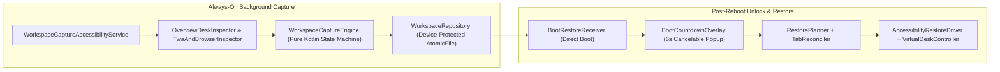

# Googlebook App Restorer


-blue)

-informational)


**Googlebook App Restorer** automatically captures and restores your multi-desk, multi-display Android Desktop / Googlebook workspace across reboots — **without requiring root or ADB**.

Once set up, it works silently in the background (even when the app window is closed), tracking open apps, exact freeform window bounds, snapped/maximized/fullscreen/minimized states, Virtual Desks (`Desk 1..N`), external monitors, Trusted Web Apps (TWAs / WebAPKs), multi-instance windows (Chrome, Files), and open Chrome tab URLs. After a reboot and screen unlock, a compact floating countdown pop-up (`6s`) restores your workspace automatically unless you press **Cancel** (`Esc`).

---

## Highlights

- **Zero Root & Zero ADB**: Built exclusively on standard, user-grantable Android APIs with guided one-tap Settings deep links.
- **Always-On Background Tracking**: Continues capturing window, desk, and Chrome tab state even when the app window is closed (`"Googlebook App Restorer is working in the background"`), flushing atomically (`AtomicFile` + `fsync`) to Device-Protected Storage on Power Menu, screen-off, and shutdown.
- **Multi-Desk & Multi-Display Fidelity (Schema v6)**:
  - Tracks windows across `Desk 1..N` and connected external displays (`DisplayManager` + `WindowMetrics`).
  - Automatically recreates missing Virtual Desks in Overview on reboot, activates each desk in sequence, and scales bounds proportionally if an external monitor was unplugged.
- **Exact Window Geometry, Z-Order & Minimized Apps**:
  - Restores exact pixel bounds and visual states (`FREEFORM`, `MAXIMIZED`, `FULLSCREEN`, `SNAPPED_LEFT`, `SNAPPED_RIGHT`, `MINIMIZED`) and Z-order stacking using `ActivityOptions.setLaunchBounds` plus WMShell caption-button / edge-drag verification.
- **TWAs, Multi-Instance Windows & Chrome Tabs**:
  - Distinguishes standalone TWAs / WebAPKs and Gemini from Chrome browser windows.
  - Preserves multiple Chrome and Files (`DocumentsUI`) windows and reconciles open Chrome tab URLs without creating duplicate tabs.
- **Smart Companion Filtering**:
  - Ignores transient cross-device phone-streaming surfaces (`Connected Phone`, `Device Link Debug`, `Cross-Device Services`) and any temporary desks spawned solely for them.
- **Cancelable Auto-Restore Pop-Up on Unlock**:
  - Waits until the lock screen (`KeyguardManager`) is dismissed after reboot, then shows a centered 6-second countdown card (**Cancel** / `Esc`, **Restore now**, or **Choose…** to cherry-pick windows).
- **100% Offline & Private**: Declares **no `INTERNET` permission** and disables cloud backup. All workspace snapshots stay strictly on-device.

---

## Quick Start & First-Time Setup

1. **Install the APK**: Download and install `GooglebookAppRestorer-release.apk` (or build from source below).
2. **Grant the 4 One-Time Permissions** in the onboarding screen:
   - *Note for sideloaded APKs on Android 13+*: Before enabling Accessibility, open **Settings → Apps → Googlebook App Restorer → ⋮ (top-right) → Allow restricted settings** once.
   - Tap each permission card in the app to jump directly to the matching Settings toggle.
3. **Close the App & Work Normally**:
   - Once armed, you can close the **Googlebook App Restorer** window. A subtle ongoing status notification (`"Googlebook App Restorer is working in the background"`) confirms background capture is active.
   - On your next reboot + unlock, your desks, windows, sizes, and Chrome tabs will automatically restore after the 6-second countdown prompt (or press `Esc` / **Cancel** to skip).

### Why Each Permission Is Needed

| Permission | Purpose |
| :--- | :--- |
| **Accessibility Service** (`BIND_ACCESSIBILITY_SERVICE`) | Observes desktop window bounds, Virtual Desks in Overview, caption states, and Chrome's top-level tab strip/omnibox (skipping `WebView` page DOMs and password fields), and recreates Virtual Desks during restore. |
| **Display Over Other Apps** (`SYSTEM_ALERT_WINDOW`) | Displays the post-reboot 6-second countdown pop-up after unlock and permits background multi-window launches on Android Desktop. |
| **Usage Access** (`PACKAGE_USAGE_STATS`) | Distinguishes minimized vs. explicitly closed windows when a single window is occluded or minimized to the shelf. |
| **Notifications** (`POST_NOTIFICATIONS`) | Shows the low-priority background status indicator and a fallback restore notification if the pop-up is deferred. |

---

## Architecture



### Module Layout

| Package | Responsibility |
| :--- | :--- |
| `capture/` | Pure-Kotlin [`WorkspaceCaptureEngine`](app/src/main/kotlin/com/google/android/desktop/apprestorer/capture/WorkspaceCaptureEngine.kt), [`WindowGeometryClassifier`](app/src/main/kotlin/com/google/android/desktop/apprestorer/capture/WindowGeometryClassifier.kt), [`UsageStatsWorkspaceReconciler`](app/src/main/kotlin/com/google/android/desktop/apprestorer/capture/UsageStatsWorkspaceReconciler.kt), and [`KnownPackages`](app/src/main/kotlin/com/google/android/desktop/apprestorer/capture/KnownPackages.kt) companion filters |
| `inspect/` | [`OverviewDeskInspector`](app/src/main/kotlin/com/google/android/desktop/apprestorer/inspect/OverviewDeskInspector.kt) (Launcher3 `DesktopTaskView` & live-tile parser) and [`TwaAndBrowserInspector`](app/src/main/kotlin/com/google/android/desktop/apprestorer/inspect/TwaAndBrowserInspector.kt) (Chrome tab strip, strict `http(s)` URL normalizer, TWA classifier) |
| `data/` & `model/` | Schema v6 [`WorkspaceSnapshot`](app/src/main/kotlin/com/google/android/desktop/apprestorer/model/WorkspaceModels.kt), [`WorkspaceSnapshotCodec`](app/src/main/kotlin/com/google/android/desktop/apprestorer/data/WorkspaceSnapshotCodec.kt), `BootToken`, and Direct-Boot [`WorkspaceRepository`](app/src/main/kotlin/com/google/android/desktop/apprestorer/data/WorkspaceRepository.kt) |
| `boot/` | [`BootRestoreReceiver`](app/src/main/kotlin/com/google/android/desktop/apprestorer/boot/BootRestoreReceiver.kt), [`BootCountdownOverlay`](app/src/main/kotlin/com/google/android/desktop/apprestorer/boot/BootCountdownOverlay.kt), and [`Notifications`](app/src/main/kotlin/com/google/android/desktop/apprestorer/boot/Notifications.kt) |
| `restore/` | [`RestorePlanner`](app/src/main/kotlin/com/google/android/desktop/apprestorer/restore/RestorePlanner.kt), [`WorkspaceRestoreCoordinator`](app/src/main/kotlin/com/google/android/desktop/apprestorer/restore/WorkspaceRestoreCoordinator.kt), [`AccessibilityRestoreDriver`](app/src/main/kotlin/com/google/android/desktop/apprestorer/restore/RestoreDrivers.kt), and [`VirtualDeskController`](app/src/main/kotlin/com/google/android/desktop/apprestorer/restore/DesktopAutomation.kt) |
| `service/` & `ui/` | Bound Accessibility & Foreground services, Material 3 Compose onboarding & live desk preview UI, and privacy-redacted [`DiagnosticsExporter`](app/src/main/kotlin/com/google/android/desktop/apprestorer/service/DiagnosticsExporter.kt) |

---

## Building, Testing & Fuzzing

### Prerequisites
- **JDK 17+**
- **Android SDK** (`compileSdk = 36`, `minSdk = 33`)

### Build APKs

```bash
./gradlew assembleDebug assembleRelease
```

- Debug APK: `app/build/outputs/apk/debug/GooglebookAppRestorer-debug.apk`
- R8-minified Release APK: `app/build/outputs/apk/release/GooglebookAppRestorer-release.apk`
  *(Optional release signing via `ANDROID_UPLOAD_KEYSTORE_PATH`, `ANDROID_UPLOAD_KEYSTORE_PASSWORD`, `ANDROID_UPLOAD_KEY_ALIAS`, and `ANDROID_UPLOAD_KEY_PASSWORD` environment variables.)*

### Run Tests, Fuzzers, Lint & Coverage

```bash
# Run unit tests, headless Robolectric Compose UI tests, SDK integration tests, and fuzzers:
./gradlew testDebugUnitTest

# Run Android Lint static analysis:
./gradlew lintDebug

# Generate JaCoCo XML/HTML test coverage report:
./gradlew createDebugUnitTestCoverageReport -Pcoverage
```

Test suites under `app/src/test/`:
- [`WorkspaceSnapshotAndGeometryTest`](app/src/test/kotlin/com/google/android/desktop/apprestorer/WorkspaceSnapshotAndGeometryTest.kt): Geometry classification, multi-display scaling, closed-app multi-desk lifecycle, occlusion/minimize reconciliation, companion filtering, and Chrome tab tracking.
- [`WorkspaceRestorerAndUiTest`](app/src/test/kotlin/com/google/android/desktop/apprestorer/WorkspaceRestorerAndUiTest.kt): Multi-desk/multi-display restore ordering, Chrome tab deduplication, Overview live-tile parsing, multi-boot repository expiration, and Robolectric Jetpack Compose UI tests.
- [`PlatformAndBootIntegrationTest`](app/src/test/kotlin/com/google/android/desktop/apprestorer/PlatformAndBootIntegrationTest.kt): Headless Android SDK integration tests for permission deep links, `BootRestoreReceiver` keyguard gating, `BootCountdownOverlay` countdown lifecycle, notifications, and Activity lifecycles.
- [`WorkspaceFuzzAndPropertyTest`](app/src/test/kotlin/com/google/android/desktop/apprestorer/WorkspaceFuzzAndPropertyTest.kt): Deterministic multi-seed fuzzing (`10,000+` randomized iterations) across JSON mutation/truncation, `BootToken` parsing, URL scheme-injection prevention, extreme/degenerate `WindowBounds` & `NaN` handling, deep UI trees, and stateful capture/restore invariants.

---

## Contributing & Security

- Contribution workflow and coding guidelines: [CONTRIBUTING.md](CONTRIBUTING.md)
- On-device security & privacy architecture and vulnerability reporting: [SECURITY.md](SECURITY.md)

## License

Licensed under the [Apache License, Version 2.0](LICENSE).
